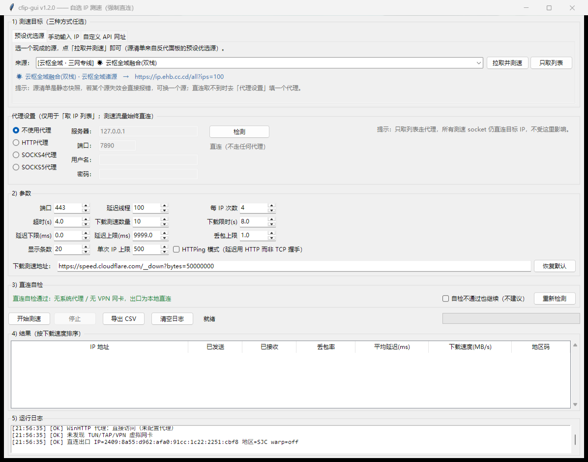

# cfip-gui —— 自选 IP 测速工具（图形界面 · 强制直连）

参考 [XIU2/CloudflareSpeedTest](https://github.com/XIU2/CloudflareSpeedTest) 的测速逻辑改造而来：**保留 TCPing 延迟测速 + 下载测速的核心链路，去掉网段扫描，改成「由你自己指定测速目标」**，并加了一层 tkinter 图形界面与直连校验。

- 目标来源三种：**预设优选源一键选**、**手动粘贴 IP**（支持 CIDR）、**自定义 API 网址**
- 测速全程**强制直连**：清空代理环境变量、所有 socket 直连目标 IP、启动前做直连自检
- 纯 Python 标准库，**零第三方依赖**，Windows / macOS / Linux 都能跑

> **预设优选源的 API 来源**：[MakkaPakka518/EmbyProxyCF-Lite](https://github.com/MakkaPakka518/EmbyProxyCF-Lite)
> 面板里的「预设优选源」下拉列表（云枢全域、104/162/172 大段家族、IPv6 星轨、第三方备用源等）
> 被整理成本项目的静态源清单，见 [`presets.py`](presets.py)。感谢原作者整理与维护这些 IP 源。



## 给不想装 Python 的人（Windows 直接双击）

1. 到 [Releases](https://github.com/LAOFIII/cfip-gui/releases/latest) 下载 `cfip-gui-windows-x64.zip`
2. **解压到任意文件夹**（不要只把 exe 拖出来，`_internal` 文件夹要和 exe 放在一起）
3. 双击 `cfip-gui.exe` —— 这就是全部步骤，不需要装 Python、不需要命令行

> 第一次运行 Windows 可能弹「Windows 已保护你的电脑」：点「更多信息」→「仍要运行」。
> 这是未签名程序的常规提示，不是病毒。

## 快速开始（从源码运行）

```bash
# 需要 Python 3.9+（Windows 用 py 启动器）
py cfip_gui.py
```

打开界面后，三种方式任选：

**① 预设优选源（最省事）** —— 默认停在这一页，下拉框选一个源，点「拉取并测速」，自动取 100 个 IP 并开始测速。想先看看取到什么，点「只取列表」。

**② 手动输入 IP** —— 粘贴 IP（每行一个，或逗号 / 空格分隔），点「开始测速」。

**③ 自定义 API 网址** —— 填网址点「只取列表（不测速）」，取回的 IP 会自动填入「手动输入 IP」页并切换过去，可先核对；停在这一页直接点「开始测速」也会先取列表再自动开测。

开始前看一眼「直连自检」一栏是否为绿色通过，测完结果表按下载速度排序，可「导出 CSV」。

> 如果某个源直连被 RST（国内访问 `ip.ehb.cc.cd` 常见），去「代理设置」选 HTTP 或 SOCKS5、
> 填 `127.0.0.1:7890` 即可 —— **只用于取 IP 列表，测速流量仍然强制直连。**

命令行模式（脚本 / 无界面环境）：

```bash
# 直连自检
py cfip_gui.py --cli --selftest

# 手动 IP
py cfip_gui.py --cli --ips "104.16.123.96,172.66.0.218" --n 100 --t 4 --dn 10 --dt 8

# 从 API 取 IP 再测
py cfip_gui.py --cli --api "https://ip.ehb.cc.cd/v6-cm?ips=100"

# 自检不通过也想跑（不建议）
py cfip_gui.py --cli --ips 1.1.1.1 --force
```

## 参数

| 参数 | 说明 | 默认 |
| --- | --- | --- |
| `--ips` | 手动输入 IP，逗号/换行/空格分隔，支持 CIDR | 空 |
| `--api` | 从网址取 IP 列表 | 空 |
| `--port` | 测速端口 | 443 |
| `--n` | 延迟测速线程数 | 100 |
| `--t` | 每个 IP 的测速次数 | 4 |
| `--dn` | 下载测速的 IP 数量 | 10 |
| `--dt` | 单个 IP 下载测速限时（秒） | 8 |
| `--url` | 下载测速地址 | `https://speed.cloudflare.com/__down?bytes=50000000` |
| `--httping` | 延迟改用 HTTPing（TCP+TLS+首字节） | 关 |
| `--csv` | 结果 CSV 路径 | `result.csv` |
| `--max` | 单次 IP 数量上限 | 500 |
| `--force` | 自检不通过仍继续 | 关 |

## 测速逻辑（沿用 cfst 的思路）

1. **延迟测速**：多线程对每个 IP 做 N 次 TCP 握手（默认 443），统计已发送 / 已接收 / 丢包率 / 平均延迟
2. **排序过滤**：按（丢包率, 延迟）升序，按延迟上下限与丢包上限过滤，得到下载测速队列
3. **下载测速**：从延迟最低的 IP 起**单线程排队**拉流，每个 IP 限时 `--dt` 秒，算出 MB/s
4. **结果排序**：按下载速度降序输出 Top N，同时写 CSV

与原项目的差异：

| 项 | 原项目 cfst | 本项目 |
| --- | --- | --- |
| 目标来源 | `ip.txt` / `ipv6.txt` 网段文件、`-ip` 参数 | 预设优选源一键选、手动粘贴、自定义 API（网段仍可用 CIDR 表达） |
| 界面 | 命令行 + 进度条 | tkinter GUI + 命令行双模式 |
| 代理 | 依赖用户自己关代理 | 主动清环境变量 + 自检系统代理 / WinHTTP / TUN 网卡 / 出口 trace |
| 测速地址地区码 | 支持多 CDN | 从 `CF-RAY` 响应头取三字码（Cloudflare） |

## 预设优选源

「预设优选源」页的 33 个源整理自 [MakkaPakka518/EmbyProxyCF-Lite](https://github.com/MakkaPakka518/EmbyProxyCF-Lite)
面板的「预设优选源」下拉列表，按原面板的分组原样保留：

| 分组 | 数量 | 示例 |
| --- | --- | --- |
| 云枢全域 · 三网专线 | 4 | 云枢全域融合、移动起飞、电信美西、联通极速 |
| 104.16.0.0/13 大段家族 | 4 | 104 全域池、104.17 移动起飞、104.19 抗QoS、104.16 老牌 |
| 162.158.0.0/15 大段家族 | 3 | 162 全域池、162.159 SaaS/DoH、162.159 电信美西 |
| 172.64.0.0/13 大段家族 | 3 | 172 全域池、172.64 联通主力、172.67 动态反代 |
| 198 & 108 专线家族 | 2 | 198.41 联通天花板、108.162 三网兜底 |
| IPv6 霄汉星轨家族 | 12 | 2400 亚太、2606 全球主干、2a06 欧洲特快等 |
| 第三方备用源 | 5 | @robberer、CM佬电信/移动/联通、v2too |

实现说明：

- 源清单是**静态快照**（写在 [`presets.py`](presets.py)），不依赖对方面板的接口，也不受其登录鉴权影响
- 原面板里「综合混合源（四源并发聚合）」和「AWS / GCP / Azure 物理机房落地」两类走的是面板自己的后端逻辑，
  没有可直接请求的 URL，因此没有收录
- 每个源的 URL 形如 `https://ip.ehb.cc.cd/104.19?ips=100`，`ips` 参数控制返回条数，可自行在「自定义 API 网址」页改大
- 这些源由第三方维护，可用性不由本项目保证；某个源挂了换个源或改用自己的源即可

## 强制直连是怎么做的

- 进程启动即删除 `HTTP_PROXY` / `HTTPS_PROXY` / `ALL_PROXY` / `NO_PROXY` 等环境变量
- 所有测速 socket 直接 `connect((ip, port))`，**不经过任何代理层**；目标 IP 由你指定，不做域名解析
- 启动自检（`direct_selftest()`）检查四件事：
  1. Windows 系统代理（注册表 `ProxyEnable`/`ProxyServer`）
  2. WinHTTP 代理（`netsh winhttp show proxy`）
  3. TUN/TAP/VPN 虚拟网卡（`netsh interface show interface`）
  4. 直连 `www.cloudflare.com/cdn-cgi/trace` 拿真实出口 IP / 地区 / warp 状态

判定规则：**VPN 网卡存在、或出口 warp≠off → 判定非直连并阻断测速**；系统代理只影响浏览器等 WinINET 应用，本程序 socket 不受其影响，因此仅告警不阻断。想强行跑可勾选「自检不通过也继续」。

## 代理设置（只用于取 IP 列表）

国内直连 `ip.ehb.cc.cd` 这类源常被 RST，所以「取 IP 列表」这一步允许走代理。**测速流量永远直连，不受这里影响。**

| 模式 | 说明 |
| --- | --- |
| 不使用代理 | 默认，纯直连 |
| HTTP代理 | HTTPS 走 `CONNECT` 隧道，支持 `Proxy-Authorization` 账号密码 |
| SOCKS4代理 | CONNECT 命令，仅支持 IPv4 目标 |
| SOCKS5代理 | 完整实现，支持账号密码认证（RFC 1929）与 IPv4/IPv6/域名目标 |

填好服务器/端口（本地 Clash 一般是 `127.0.0.1:7890`）后点「检测」即可验证：
能穿透到目标 443 会显示绿色 `✔ SOCKS5代理 可用`，失败会给出具体原因（认证错误、连接被拒绝、目标不可达等）。

代理实现在独立的 [`proxycfg.py`](proxycfg.py)，纯标准库手写 SOCKS 握手，不依赖 PySocks。
密码只存在内存，不写盘、不进日志。

## 边界情况

| 情况 | 行为 |
| --- | --- |
| 输入为空 | 弹窗「没有可测的 IP」，不启动 |
| IP 格式非法 | 跳过该条，日志列出被忽略的项；全部非法时同上弹窗 |
| IP 超过上限 | 截断到上限并提示 |
| API 不可达 / 超时 | 重试 2 次，失败后弹窗给出错误原因与排查建议 |
| API 返回空或解析不到 IP | 明确报错，并打印返回内容前 200 字便于判断格式 |
| 自检未通过 | 阻断测速并弹窗说明原因（可强制继续） |
| 所有 IP 都没通过延迟过滤 | 提示放宽延迟/丢包条件 |
| 下载测速全部 0 | 结果表照常输出延迟数据，日志给出每个 IP 的失败原因（状态码/超时等） |

API 返回格式兼容：纯文本每行一个 IP、逗号/空格分隔、JSON 数组、JSON 对象里的字符串数组。

## 目录

```
cfip_gui.py        # 主程序（GUI + CLI + 测速核心 + 直连自检）
presets.py         # 预设优选源清单（33 个源，来自 EmbyProxyCF-Lite 面板）
proxycfg.py        # 取列表用的 HTTP / SOCKS4 / SOCKS5 代理（纯标准库）
README.md
LICENSE
docs/screenshot.png
build_exe.bat      # 一键打包 Windows exe（需 PyInstaller）
```

## 自己打包 exe

```bash
py -m pip install pyinstaller
build_exe.bat
# 产物：dist\cfip-gui\cfip-gui.exe（连同 _internal 目录一起分发）
```

> 用 `--onedir` 而不是 `--onefile`：单文件模式启动时要把自身解压到 `%TEMP%`，
> 部分杀软会拦这一步并报 `Could not create temporary directory!`，onedir 没有这个坑，启动也更快。

## 已知限制

- 下载测速是单线程排队，与 cfst 一致；想更快可以把 `--dn` 调小
- 裸 IP + SNI 测速必然证书不匹配，程序不校验证书（只测速，不传敏感数据）
- 地区码只解析 Cloudflare 的 `CF-RAY`；其他 CDN 会显示 `N/A`
- `speed.cloudflare.com` 对超大 `bytes` 参数会返回 403，默认用 50 MB

## 致谢

- 测速逻辑参考 [XIU2/CloudflareSpeedTest](https://github.com/XIU2/CloudflareSpeedTest)
- 预设优选源整理自 [MakkaPakka518/EmbyProxyCF-Lite](https://github.com/MakkaPakka518/EmbyProxyCF-Lite)
- 各 IP 源由对应第三方维护者提供，本项目仅做聚合与测速

## License

MIT
